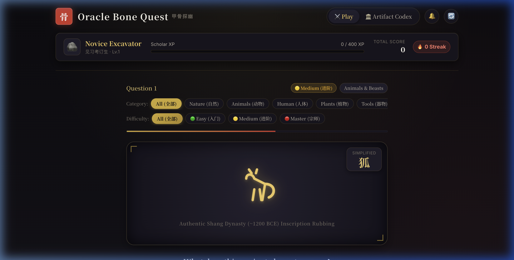
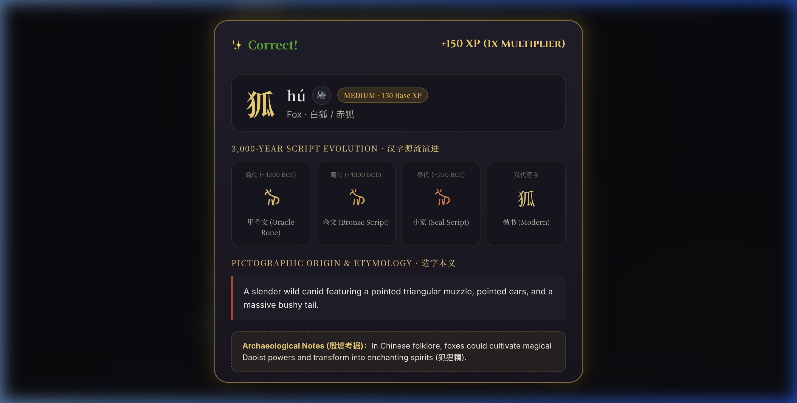
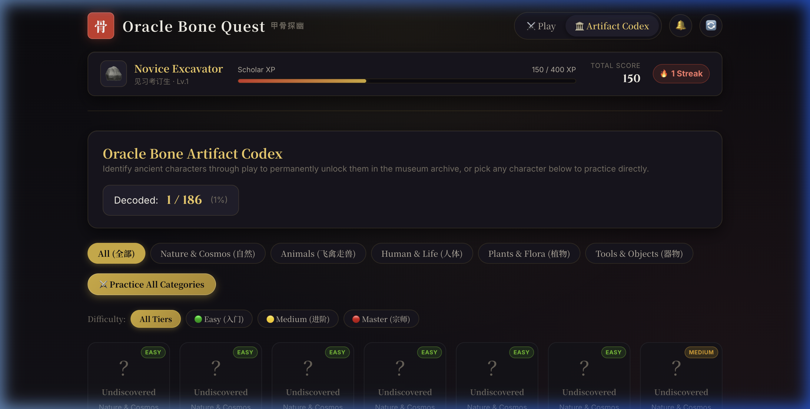

# Oracle Bone Quest · 甲骨探幽 🪨✨

[](https://github.com/ssajj1212/chinese-character-guessing/actions/workflows/deploy.yml)
[](https://github.com/ssajj1212/chinese-character-guessing)
[](https://github.com/ssajj1212/chinese-character-guessing)
[](https://vitejs.dev/)
[](https://opensource.org/licenses/MIT)

> **Travel 3,200 years back to the Shang Dynasty (商代, c. 1200 BCE).**  
> Test your archaeological intuition by deciphering the earliest known Chinese writing carved on ox scapulae and turtle plastrons (甲骨文).

🎮 **[Play Live on GitHub Pages](https://ssajj1212.github.io/chinese-character-guessing/)** *(Works directly on mobile & desktop browsers)*

---

## 📸 Interface Preview

### 1. Interactive Divination Arena
Guess the modern meaning of authentic ink-rubbing style Oracle Bone glyphs before the 15-second incense timer expires. Build streak multipliers and earn Scholar XP.



---

### 2. Etymological Evolution & Cultural Notes
Every round reveals the complete 3,000-year script evolution across 4 historical eras: **Oracle Bone (甲骨文) ➔ Bronze Script (金文) ➔ Small Seal (小篆) ➔ Modern Regular (楷书)**, paired with paleographic explanations and Shang divination fun facts.



---

### 3. Artifact Codex (甲骨秘卷)
Browse and inspect 186 curated ancient characters. Filter by category or difficulty, search by English meaning or Pinyin, inspect locked vs. unlocked artifacts, or click **"⚔️ Challenge This Inscription"** to practice any specific glyph.



---

## 🌟 Key Features

- 🏺 **Authentic Vector Glyphs**: 186 high-fidelity SVG pictographs with organic chisel contours and authentic ink-rubbing glow filters.
- 📜 **Complete 4-Era Evolution**: Visualizes how each character evolved from Shang bone carvings to Zhou bronze vessels, Qin unified seals, and modern Hanzi.
- 🎓 **5-Tier Scholar Progression**: Rank up from *Novice Excavator (见习考订生)* to *Grand Epigrapher (甲骨宗师)* as your streak and XP grow.
- 🔔 **Zero-Asset Procedural Audio**: Authentic ancient bronze chime bells (*Biānzhōng* 编钟) and wooden temple blocks (*Mùyú* 木鱼) synthesized in real-time via the HTML5 Web Audio API — zero heavy audio downloads.
- 📱 **Responsive & Accessible**: Optimized for touchscreens, mobile devices, keyboard shortcuts, and screen readers.
- 🧪 **100% Test-Covered Engine**: Comprehensive Vitest test suite validating scoring math, streak algorithms, dataset integrity, and audio fallbacks.

---

## 🔬 Data Curation & Paleographical Methodology

The database was systematically curated to balance archaeological authenticity with engaging educational gameplay:

| Dimension | Details |
| :--- | :--- |
| **Historical Period** | Late Shang Dynasty (商朝晚期, c. 1250 – 1046 BCE), Yinxu (殷墟, modern Anyang, Henan). |
| **Glyph Sourcing** | Derived from archaeological ink rubbings (*tàpiàn* 拓片) and verified against standard paleographical corpora (e.g., 《甲骨文合集》, 《甲骨文字编》). |
| **Vectorization Pipeline** | Each character is crafted as clean, scalable SVGs using responsive `viewBox="0 0 100 100"`. Chisel stroke dynamics and varying widths are preserved. |
| **Evolution Stages** | Cross-referenced with the *Shuowen Jiezi* (《说文解字》) and epigraphic studies to map accurate Bronze (*Jīnwén*) and Seal (*Xiǎozhuàn*) counterparts. |
| **Dual Language Support** | Full bilingual support across English definitions, Standard Pinyin with tone marks, and Chinese cultural explanations. |

### Thematic Categories (5 Modules)
1. **Nature & Cosmos (自然天象)**: Celestial bodies, weather, and terrain (*日, 月, 雨, 山, 川, 气, 泉...*)
2. **Fauna & Creatures (鸟兽动物)**: Animals domesticated and hunted by the Shang (*象, 虎, 鹿, 龟, 马, 鱼...*)
3. **Human & Anatomy (人体形态)**: Body postures, senses, and family roles (*人, 目, 齿, 手, 耳, 母, 子...*)
4. **Tools & Ritual Objects (器物礼器)**: Weapons, vessels, and agricultural tools (*鼎, 鬲, 爵, 车, 弓, 斤, 甲...*)
5. **Abstract & Actions (动作概念)**: Verbs and divination concepts (*见, 听, 行, 涉, 伐, 孕, 天...*)

---

## 🚀 Quick Start (Local Development)

### Prerequisites
- [Node.js](https://nodejs.org/) (version 18+ recommended)
- `npm` (version 9+)

### Installation & Launch
```bash
# 1. Clone repository
git clone https://github.com/ssajj1212/chinese-character-guessing.git
cd chinese-character-guessing

# 2. Install dependencies
npm install

# 3. Start local development server
npm run dev
```

Open your browser at `http://localhost:4173/` to play!

### Other Commands
```bash
# Run unit & integration test suite (Vitest)
npm test

# Build production bundle for static hosting
npm run build

# Preview production build locally
npm run preview
```

---

## 🌐 Deploying to GitHub Pages

This project is configured with an automated CI/CD pipeline (`.github/workflows/deploy.yml`).

To publish your own fork or branch to GitHub Pages:

1. Push your changes to GitHub:
   ```bash
   git push origin <your-branch>
   ```
2. In your GitHub repository, navigate to **Settings** ➔ **Pages**.
3. Under **Build and deployment** ➔ **Source**, select **GitHub Actions**.
4. The deployment workflow will automatically run, test, build, and publish the site to:
   ```
   https://<your-username>.github.io/chinese-character-guessing/
   ```

---

## 📁 Project Architecture

```
chinese_character_guessing/
├── .github/
│   └── workflows/
│       └── deploy.yml            # Automated GitHub Pages CI/CD workflow
├── data/
│   └── characters.json           # 186 curated characters with SVG evolution & notes
├── docs/
│   └── images/                   # UI previews and documentation screenshots
│       ├── gameplay_arena.png
│       ├── etymology_evolution.png
│       └── artifact_codex.png
├── index.html                    # Semantic HTML5 app shell & dialogs
├── package.json                  # Dependencies & scripts (Vite, Vitest, JSDOM)
├── scripts/
│   ├── dataset_characters_expanded.js  # Extended vector dataset generator
│   └── scrape_wikipedia.js      # Reference scraper for paleographical data
├── src/
│   ├── css/                      # Modular Vanilla CSS (custom design system)
│   │   ├── variables.css         # Parchment & bronze palette tokens
│   │   ├── base.css              # Typography & resets
│   │   ├── game.css              # Divination arena styles
│   │   ├── codex.css             # Artifact Codex styles
│   │   ├── reveal.css            # Evolution modal styles
│   │   └── animations.css        # Rubbing glow & tile transitions
│   └── js/
│       ├── audio.js              # Procedural Web Audio synthesizer (bells & woodblock)
│       ├── codex.js              # Codex collection filtering, searching & view
│       ├── engine.js             # Question generation & option randomization
│       ├── state.js              # Scholar level, streak, XP & mastery tracking
│       ├── storage.js            # Safe localStorage wrapper
│       └── main.js               # Event coordinator & DOM orchestrator
├── tests/                        # Vitest test suite (7 test files, 31 tests)
└── vite.config.js                # Vite config with relative base path for GitHub Pages
```

---

## 📜 Cultural Heritage & License

- **Software Code:** Released under the [MIT License](LICENSE).
- **Archaeological Cultural Heritage:** Oracle bone pictographs represent ancient Chinese cultural heritage dating back to the late 2nd millennium BCE. Vector representations and educational data are provided for open educational, research, and non-commercial preservation purposes.
